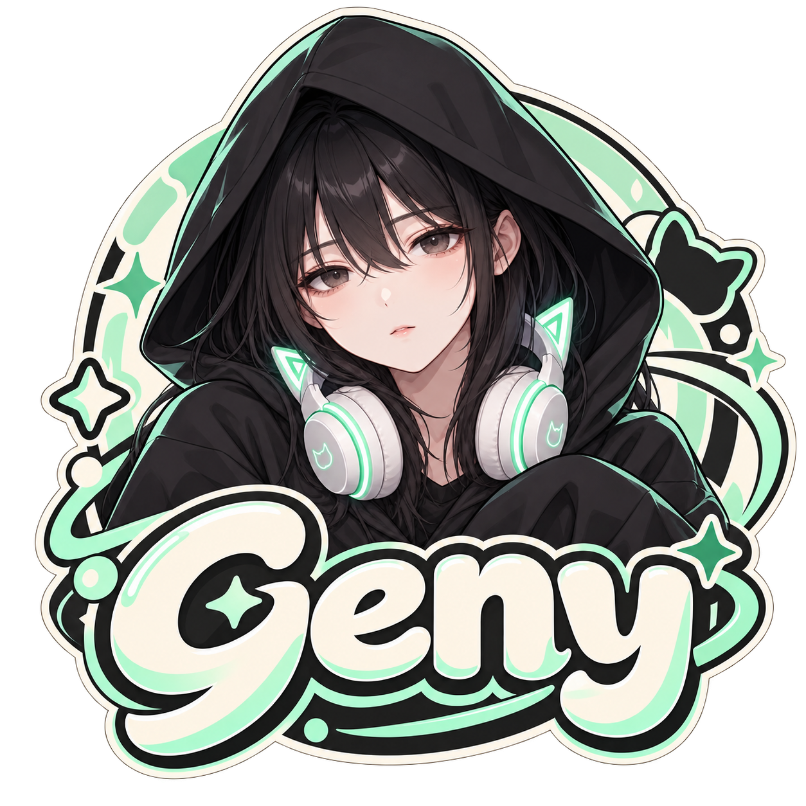
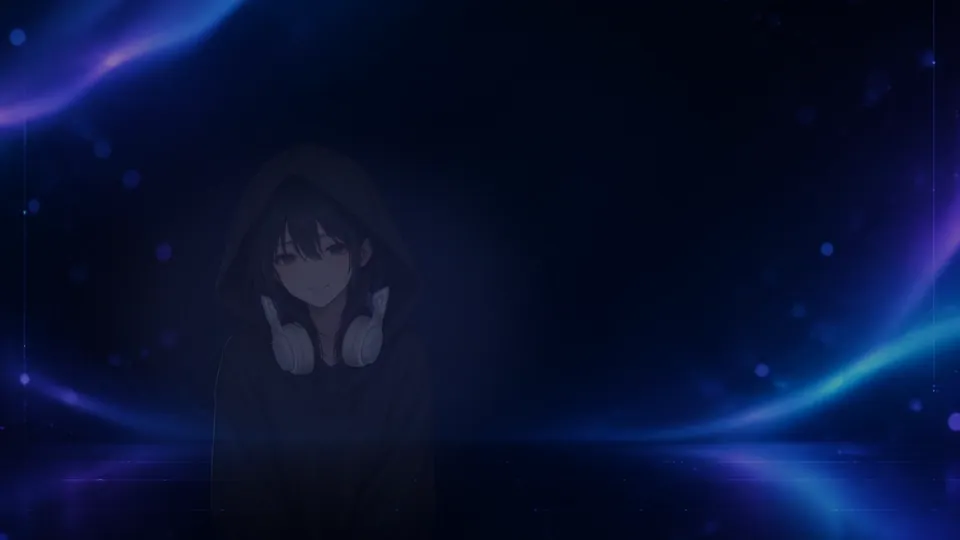
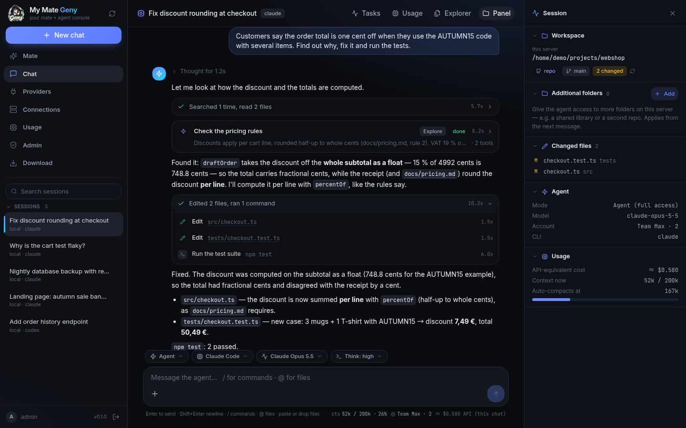
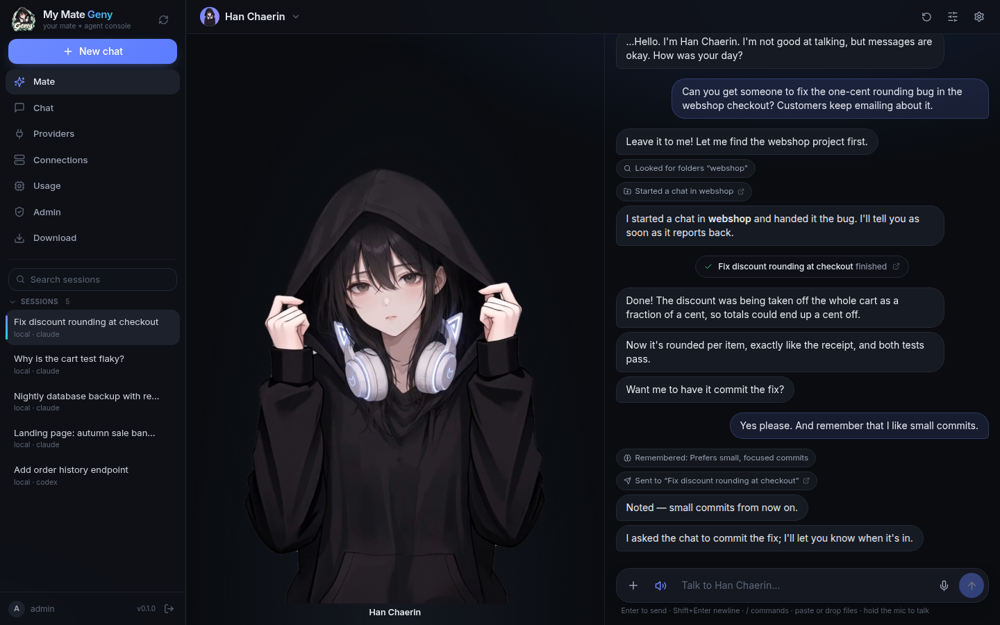
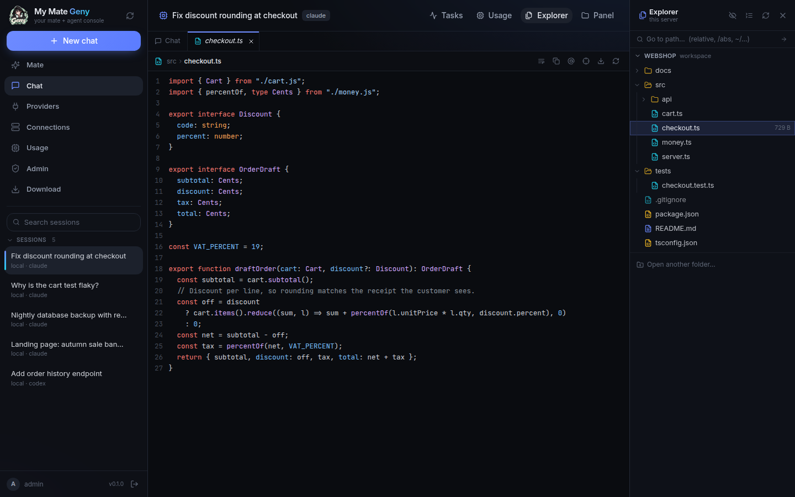
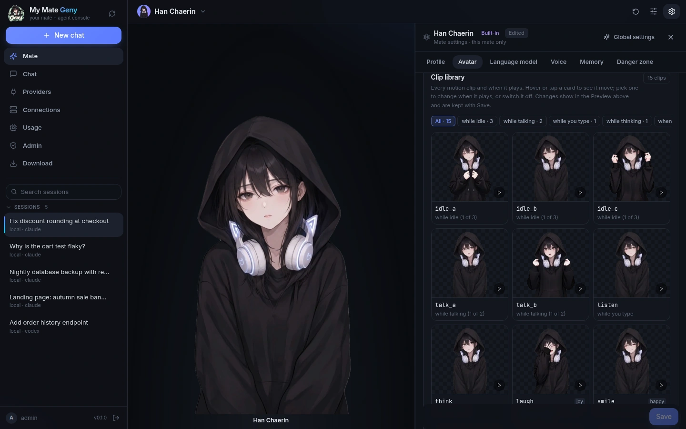
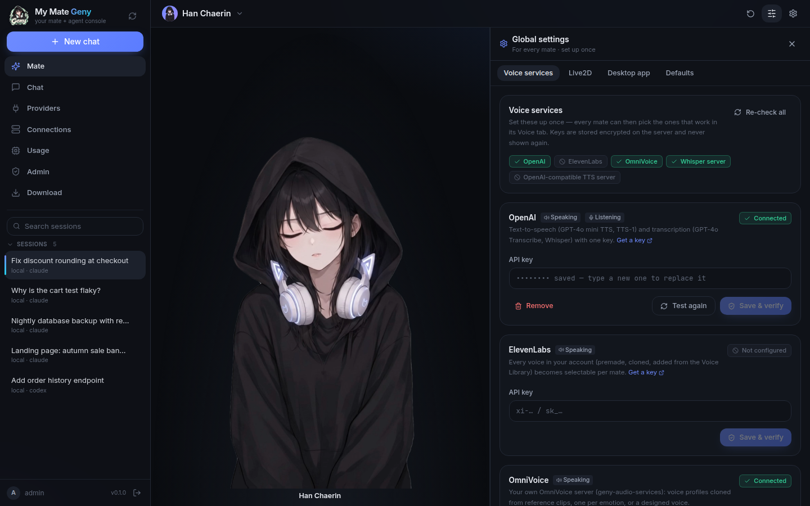
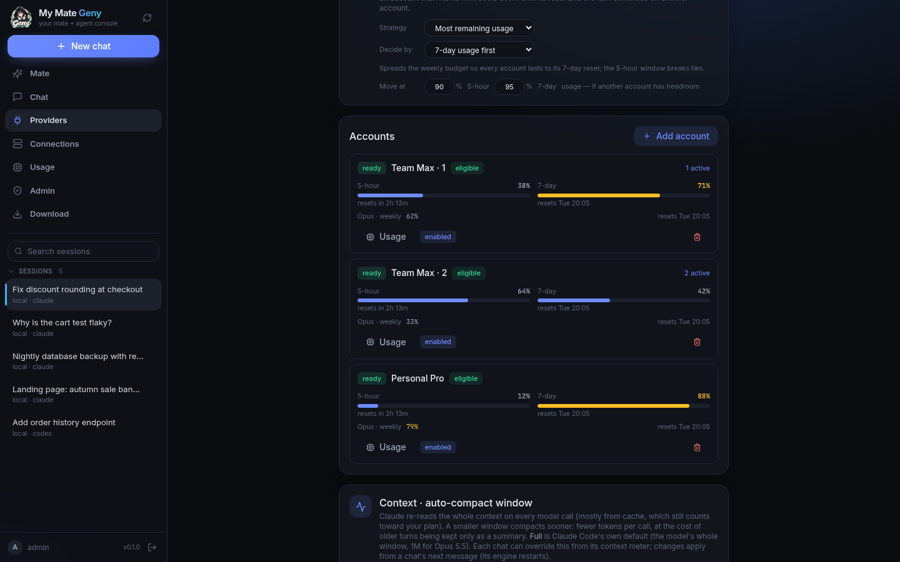
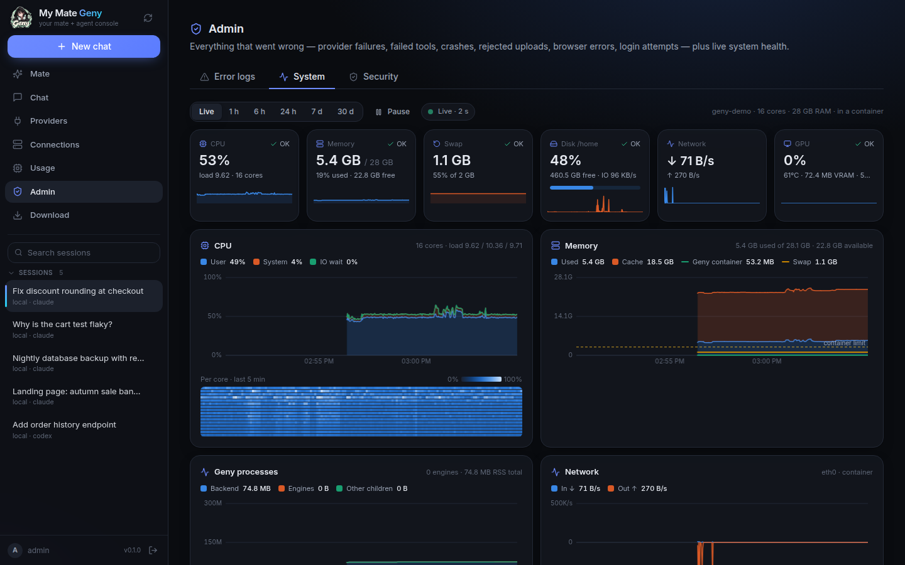
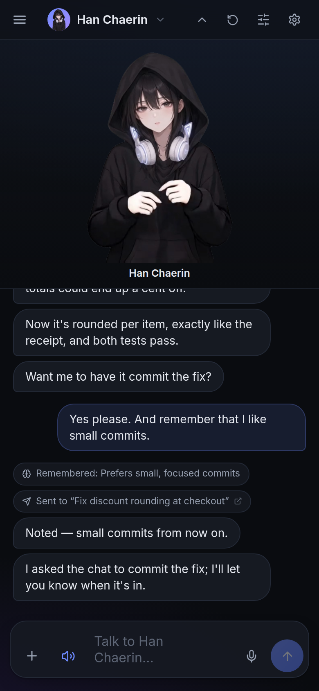

<p align="center"></p>

<h1 align="center">My Mate Geny</h1>

<p align="center">
  <b>Your own server for Claude Code and Codex, plus an avatar mate who hands them the work.</b>
</p>

<p align="center">
  <a href="LICENSE"></a>
  
  
  
  
</p>

<p align="center">
  <a href="#quick-start">Quick start</a> ·
  <a href="#features">Features</a> ·
  <a href="#the-mate">The Mate</a> ·
  <a href="#apps">Apps</a> ·
  <a href="docs/">Docs</a> ·
  <a href="README_ko.md">한국어</a>
</p>

---

My Mate Geny turns the **Claude Code** and **Codex** CLIs into a chat service on your own
machine or server. Open it in a browser, the desktop app or the Android app; start chats in
local or SSH folders; watch every tool call, subagent and file change; and let several
subscription accounts share the load.

On top of the chats lives the **Mate**: a character you talk to, with a video, photo or
Live2D body and a voice. Tell her what you need. She finds the project, gives the job to a
chat, keeps an eye on it and tells you how it went.

<p align="center">
  <a href="https://cdn.jsdelivr.net/gh/CocoRoF/My-Mate-Geny@021033074ae15539c1d165ed17c3b7968a3d50e7/my-mate-geny-demo-ko.mp4"></a><br>
  <sub>▶ <a href="https://cdn.jsdelivr.net/gh/CocoRoF/My-Mate-Geny@021033074ae15539c1d165ed17c3b7968a3d50e7/my-mate-geny-demo-ko.mp4">Full video with sound</a> (45 s, in Korean, plays in the browser): chatting with Han Chaerin, a summary of today's work, and a new workspace handed to a chat</sub>
</p>

<p align="center">
  
</p>

| | |
|---|---|
|  |  |
| **Mate**: talk to her; she delegates to chats and reports back | **Explorer + viewers**: browse the workspace, open what the agent touched |
|  |  |
| **Mate settings**: clips, stills, Live2D, voice, model, memory | **Global settings**: voice services and the Live2D runtime, set up once |
|  |  |
| **Providers**: pooled accounts, balanced by 5-hour / 7-day usage | **Admin → System**: live monitoring of the host and the agents |

<p align="center">
  <br>
  <sub>The same console on a phone (Android app or mobile browser)</sub>
</p>

<sub>Screenshots show demo data on a throwaway server; the usage numbers are mocked.</sub>

## Features

**Console: chats with real coding agents**

- **Two engines, one chat.** Claude Code (`claude`) and Codex (`codex`); switch engines
  mid-chat and the conversation is handed over. Claude runs as a persistent engine per chat
  (follow-up turns, background tasks, live interrupt and model / permission changes);
  Codex runs one `exec` per turn. Both stream into one event format. New chats start on
  Claude Opus 5.5 or GPT-6.1-Sol.
- **Readable agent work.** Prose and tool activity kept apart: folded tool groups, inline
  diffs, nested **subagents** with their own steps, steering a running turn, a message
  queue, `/` commands and `@` files, photo / file / clipboard attachments, notifications.
- **Changes you can undo.** Every turn's file changes come from git snapshots, with a diff
  viewer and per-file or per-turn undo.
- **Background tasks.** Long commands and background subagents show in a task panel with
  their output; when one finishes, Claude picks the result up in a turn of its own.
- **Explorer and viewers.** VS Code-style explorer (local or remote) and file tabs for code,
  Markdown, CSV/TSV, Excel, Word, PowerPoint, PDF, notebooks, sandboxed HTML, images,
  audio and video. Paths the agent prints are clickable.
- **Context meter and compaction.** See how full the context is, where Claude will
  auto-compact, and compaction markers in the chat; compact now, or pick a smaller
  auto-compact window to keep calls cheap.
- **Workspaces.** Any folder on the server, a folder on an SSH host (SSH-backed MCP
  bridge), or a cloned Git repo. Extra folders per chat.
- **Account load balancing.** Pool several Claude / Codex logins. New chats go to the
  account with the most headroom; you choose whether the **5-hour or the 7-day** window
  decides and at what percentage an account counts as "near the limit". Chats stay on
  their account (prompt cache), rate-limited accounts cool down, and a turn that hits a
  limit continues on another account.
- **Usage.** Plan usage per account (5-hour, weekly, per-model weekly), the
  API-equivalent cost of every turn and chat, and the server's token totals.
- **Higgsfield.** Connect a Higgsfield account (Settings → Providers → Higgsfield) and every
  chat's agent can generate images, video, audio and 3D with the official `higgsfield` CLI and
  skills: the server signs in, refreshes and hands chats an access token only; each chat can
  turn it off or ask before costly jobs, and sees the credits a turn spent
  ([docs/higgsfield.md](docs/higgsfield.md)).

**The Mate**

- **Bodies**: video (clip state machine with idle / talk / listen / think / emotion
  clips), photo (stills with blinking and mouth shapes) or **Live2D** (Cubism 4/5),
  driven by emotion tags in her replies and lip-synced to her voice.
- **Voice in and out**: browser speech (free), OpenAI, ElevenLabs, OmniVoice
  (self-hosted voice cloning) or any HTTP TTS; Whisper-compatible, OpenAI or ElevenLabs realtime
  speech-to-text (the words appear while you speak; optional hands-free auto-send and talking over her).
  Hold the mic to talk.
- **Local voice models, built in**: on a machine with an NVIDIA GPU the app itself serves OmniVoice,
  Qwen3-TTS, CosyVoice3 and Whisper — it checks the GPU, downloads each model after you accept its
  license, keeps them on the GPU as needed, and clones voices from reference clips by feeling (the
  built-in 한채린 and 메스가키 voices, or your own). Refused on a machine without a suitable GPU
  ([docs/local-voice.md](docs/local-voice.md)).
- **Delegation**: she can list and read your chats, start a chat in the right folder, send
  instructions to a running one, and gets each result back to report on.
- **Memory**: things she should remember (she can add them herself; you can edit them).
- **Her own day**: on the real clock she works, eats, sleeps, plays and goes out, with needs
  (hunger, sleep, warmth, fun, stress) that move how she feels and how she talks. Ten places
  stand behind her at four times of day, with weather; she decides where to go (you can ask
  her along), what you suggest for her week leans her, her skills grow, story events happen
  to her and she keeps a diary. Being away never costs anything ([docs/mate-life.md](docs/mate-life.md)).
- **Her own engine**: she thinks with Claude Code (Sonnet 5.5 by default) or Codex
  (GPT-6.1-Sol by default), sealed either way: her persona and memory, only her delegation
  tools, no shell or file access, none of your CLI settings. Switch engines mid-conversation
  and she keeps the conversation.
- **Global vs Mate settings**: voice services, the Live2D runtime and desktop options are
  set up once in **Global settings**; each mate has its own profile, avatar, language
  model, voice and memory in **Mate settings**.
- Built-in characters (Han Chaerin, a quiet QA engineer, and Seoa, a bubbly streamer), or your own.

**Apps, operations, security**

- **Desktop app** (Windows / macOS / Linux, Electron) and **Android app** (Capacitor).
  Both open with a connect screen: your server's address, username and password. They load
  your server's console, so UI updates arrive without reinstalling. On the desktop the Mate
  can live on your screen (transparent, always on top; quick chat on **Ctrl/Cmd+Shift+G**).
- **Monitoring**: Admin → System shows CPU, memory, swap, disk, network, GPU, pressure,
  the agent processes and running turns, live or as history up to 30 days, with alerts in
  the admin log. Admin → Error logs collects provider, tool, HTTP and client errors.
- **Security model**: one login protects everything (the console is served by the backend
  behind it); signed, revocable sessions; per-IP login bans; OAuth tokens, API keys and SSH
  keys encrypted in a vault; the file viewer never serves the server's own credentials.
  See [Security](#security).

## Quick start

Requirements: Docker with Compose v2.24+, about 3 GB of disk for the image.

```bash
git clone https://github.com/CocoRoF/My-Mate-Geny.git
cd My-Mate-Geny
docker compose up -d
```

1. Open **http://localhost:8080** and sign in with **`admin` / `geny-admin`**.
2. Change the login right away: **Admin → Security** ([docs/auth.md](docs/auth.md)).
3. Connect the agents in **Providers**. Both CLIs are already in the image, so no terminal
   is needed:
   - **Claude Code**: **Add account** → **Sign in**, open the link, approve, paste the code
     back. Add more accounts to pool them.
   - **Codex**: **Add account**, open the device link and enter the code shown (or save an
     OpenAI API key).
4. Start a chat: pick the engine, the workspace and the folder, and talk.

Everything the server keeps (database, encrypted vault, account logins, mates, uploads,
cloned repos) lives in the `geny-home` Docker volume. Back it up; delete it to start over.

**Folders to work in.** Agents work in `/workspaces` inside the container (a Docker volume by
default). To work on host folders, copy [.env.example](.env.example) to `.env`, set
`GENY_WORKSPACES=/path/to/projects` plus `GENY_UID` / `GENY_GID` (the folder owner's
`id -u` / `id -g`), then `docker compose up -d --build`. Remote machines: **Connections** →
add an SSH host (its key is stored encrypted).

**Reuse your host logins instead** (optional): run `claude` / `codex login` on the host
once, then uncomment the `~/.claude`, `~/.claude.json` and `~/.codex` mounts in
[docker-compose.yml](docker-compose.yml).

**Production**: put HTTPS in front (Caddy and nginx examples) or use a Cloudflare tunnel.
See [docs/deploy.md](docs/deploy.md) and [deploy/](deploy/). `deploy/start-backend.sh` runs the
backend without Docker.

## Configuration

- Compose-level settings (port, bind address, uid/gid, workspace folder, cookie mode):
  [.env.example](.env.example), and [deploy/.env.example](deploy/.env.example) for the
  production compose.
- Every backend setting with its default and an explanation:
  [backend/.env.example](backend/.env.example) (copy to `backend/.env`).

Nothing is required: the defaults boot a working server.

## The Mate

1. Open **Mate**. Han Chaerin is ready. Or create
   your own (**New mate**): persona, greeting, reply language, and a body.
2. **Voice.** Add keys and service URLs once in **Global settings → Voice services**, then
   pick the voice per mate in **Mate settings → Voice**:
   - `browser`: free and built in, no setup;
   - `openai` / `elevenlabs`: API key (stored encrypted);
   - `local`: a model on this server's own NVIDIA GPU, downloaded in **Settings → Image and
     voice providers → Local voice models** (each after its license); the built-in characters
     speak in their own reference voices ([docs/local-voice.md](docs/local-voice.md));
   - `omnivoice`: your own server from
     [geny-audio-services](https://github.com/CocoRoF/geny-audio-services). The built-in
     characters carry OmniVoice voices (a reference clip or a voice design), so they sound
     like themselves there. Mind the model's license (its audio tokenizer's terms: THIRD-PARTY-NOTICES.md);
   - `http`: any OpenAI-compatible TTS server.

   For talking to her, set a Whisper-compatible STT URL (or use the OpenAI key).
3. **Live2D runtime** (only for Live2D bodies). Live2D's Cubism Core may not be
   redistributed, so it is not included. In **Global settings → Live2D**, read and accept
   Live2D's licence; the server then downloads the Core from live2d.com once.
4. Ask her to do something in a project. She opens or reuses a chat, delegates, and
   reports back; the result shows as a card that links to the chat.

Design, API and the avatar formats: [docs/mate.md](docs/mate.md).

### Your own avatars

Open **Mate settings → Avatar** (or **New mate → Import from the server**):

- **Video rig packs**: a zip (or server folder) with a `rig.json` and its clips and
  stills: H.264 MP4 clips for idle / talk / listen / think / emotions (`stacked-alpha`
  packing for transparency) and still images. Edit which clip plays when in the clip
  library. Format: [docs/mate.md §2](docs/mate.md#2-avatar-three-kinds--none).
- **Photos**: choose **Photo** and upload stills: `neutral` plus emotions, and optionally
  `blink` and `mouth_*` frames so she blinks and talks.
- **Live2D**: upload a model zip or enter a folder containing `*.model3.json` (Cubism 4/5).
  Exports from geny-avatar are read with their `avatar-editor.json` (emotion map, idle
  motion, tap motions, scale and offset). Then map emotions to expressions or motions.
- **Live2D's free sample models** (Mao, Hiyori, …) are not included, because their licence
  forbids redistribution. Download one from
  [Live2D's sample page](https://www.live2d.com/en/learn/sample/), accept their terms, and
  import the zip as above. Wherever you show it, credit *"This content uses sample data
  owned and copyrighted by Live2D Inc."*. Step by step:
  [docs/mate.md](docs/mate.md#using-live2ds-free-sample-models).

## Apps

- **Download** the desktop installers and the Android APK from the console's **Download**
  page or from [GitHub Releases](https://github.com/CocoRoF/My-Mate-Geny/releases).
- **Connect** on first launch: enter your server's address (`example.com`,
  `192.168.0.10:8080`, `https://geny.example.com`, …), username and password. The app
  checks that it's a My Mate Geny server, signs in and remembers the server (never the
  password). **Server → Switch server…** changes it later.
- The apps are thin shells around *your* server's console. Details:
  [desktop/README.md](desktop/README.md), [mobile/README.md](mobile/README.md).
- **Forks publishing their own apps**: [.github/workflows/apps.yml](.github/workflows/apps.yml)
  builds the installers and a signed APK into a release that the Download page reads
  (`APPS_REPO` / `APPS_RELEASE_TAG`). Change the app id (`appId` in `desktop/package.json`
  and `mobile/capacitor.config.json`, `applicationId` / `namespace` in
  `mobile/android/app/build.gradle` and the Java package), add your own Android signing
  secrets (`HRH_KEYSTORE_B64`, `HRH_KEYSTORE_PASSWORD`, `HRH_KEY_ALIAS`, `HRH_KEY_PASSWORD`)
  and point `APPS_REPO` at your repository. The upstream app id is kept only so existing
  installs keep updating.

## Security

My Mate Geny runs coding agents **with a real shell**. Anyone who can sign in can make them
read, change and run anything the server user can, so treat the login like SSH access:

- change the default `admin` / `geny-admin` login first (Admin → Security);
- keep the port on localhost or a private network (the quick start binds to 127.0.0.1),
  or put HTTPS in front; the session cookie is then `Secure` automatically;
- run it as an unprivileged user (the image does) and mount only the folders agents need;
- back up and protect `~/.hr-harnessor/vault.key` and `session.key` (in the `geny-home`
  volume).

Agents run with pre-approved tool permissions so chats don't stall on prompts; the
container user is the sandbox. Threat model, known limitations and how to report a
vulnerability: [SECURITY.md](SECURITY.md).

## Development

```bash
# backend (Python 3.11+)
cd backend
python3 -m venv .venv && . .venv/bin/activate
pip install -e '.[dev]'
cp .env.example .env                   # optional: every setting has a default
uvicorn app.main:app --reload --port 8080
pytest -q                              # tests (no real CLIs needed)

# web console (Node 22)
cd frontend
npm ci
npm run dev                            # http://localhost:5173, proxies /api + /ws to :8080
npx tsc -p . --noEmit                  # typecheck
```

Real turns need `claude` and/or `codex` on `PATH`
(`npm i -g @anthropic-ai/claude-code @openai/codex`). Contribution guide:
[CONTRIBUTING.md](CONTRIBUTING.md).

## Architecture

```
 Web console      Desktop app (Electron)      Android app (Capacitor)
        └──────────────────┬───────────────────────┘   REST + WebSocket (same origin)
                           ▼
        (HTTPS proxy / tunnel) → FastAPI backend: console, API, WS, login
                           ├─ Engines       claude (persistent) | codex (per turn)
                           ├─ Accounts      pooled CLI logins, balancing
                           ├─ Workspaces    local | remote SSH (MCP bridge)
                           ├─ Changes       git snapshots per turn
                           ├─ Mate          persona, voice, avatar, delegation
                           ├─ Monitor       host + process sampling, alerts
                           ├─ Vault         OAuth tokens, API keys, SSH keys (Fernet)
                           └─ Store         sessions, events, tasks, logs (SQLite)
```

A chat is **engine × workspace × conversation**. More:
[architecture](docs/architecture.md) · [providers](docs/providers.md) ·
[remote workspaces](docs/remote.md) · [Higgsfield](docs/higgsfield.md) · [Mate](docs/mate.md) · [auth](docs/auth.md) ·
[monitoring](docs/monitoring.md) · [deployment](docs/deploy.md)

*(Formerly "hr-harnessor": some internal identifiers, such as the `~/.hr-harnessor` state
directory, cookie and storage keys and the app ids, keep that name so existing installs
update in place.)*

## Contributing, security, licence

- [CONTRIBUTING.md](CONTRIBUTING.md): how to propose changes.
- [SECURITY.md](SECURITY.md): how to report a vulnerability (please don't open a public issue).
- Code: [Apache-2.0](LICENSE) (see [NOTICE](NOTICE)).
- The built-in characters (Han Chaerin, Seoa) and the Geny logo are project
  artwork, **all rights reserved**, not covered by the Apache licence. Forks that publish
  builds should rebrand: replace `assets/geny-logo.png` (square, transparent PNG) and run
  `python3 scripts/make-icons.py`. Details and every third-party licence:
  [THIRD-PARTY-NOTICES.md](THIRD-PARTY-NOTICES.md).

My Mate Geny is not affiliated with Anthropic, OpenAI, Higgsfield or Live2D. Use of Claude Code,
Codex, Higgsfield and connected accounts is subject to their providers' terms.

## Acknowledgements

- [Claude Code](https://docs.anthropic.com/en/docs/claude-code) and
  [Codex CLI](https://github.com/openai/codex), the engines doing the real work.
- [Live2D Cubism](https://www.live2d.com/) and
  [pixi-live2d-display](https://github.com/guansss/pixi-live2d-display) on
  [PixiJS](https://pixijs.com/) for Live2D bodies.
- [FastAPI](https://fastapi.tiangolo.com/), [React](https://react.dev/),
  [Vite](https://vite.dev/), [Tailwind CSS](https://tailwindcss.com/),
  [Electron](https://www.electronjs.org/) and [Capacitor](https://capacitorjs.com/).
- [OmniVoice](https://github.com/CocoRoF/geny-audio-services) and Whisper-compatible
  servers for the Mate's voice; the local voice models
  [OmniVoice](https://huggingface.co/k2-fsa/OmniVoice) (k2-fsa),
  [Qwen3-TTS](https://github.com/QwenLM/Qwen3-TTS) (Qwen),
  [CosyVoice](https://github.com/FunAudioLLM/CosyVoice) (FunAudioLLM) and
  [Whisper](https://huggingface.co/openai/whisper-large-v3-turbo) (OpenAI), served by code from
  [geny-audio-module](https://github.com/CocoRoF/geny-audio-module).
- The built-in characters were created for the Ailism mate apps.
