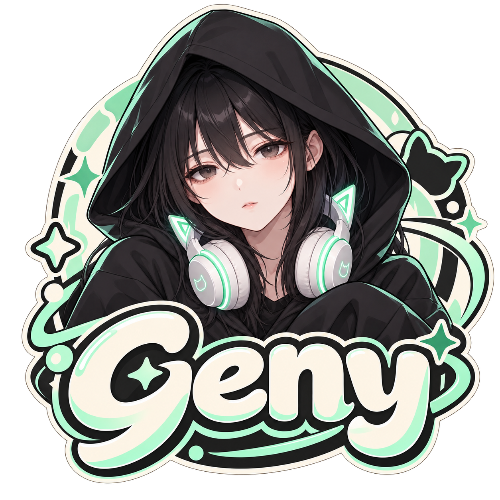
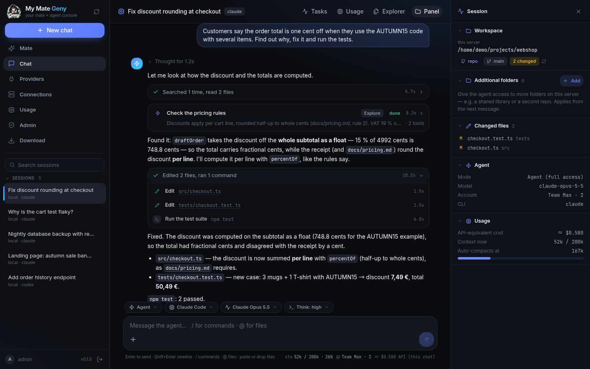
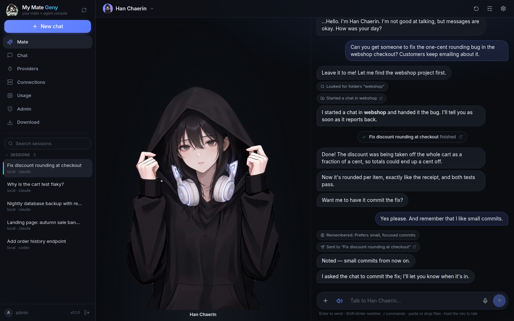
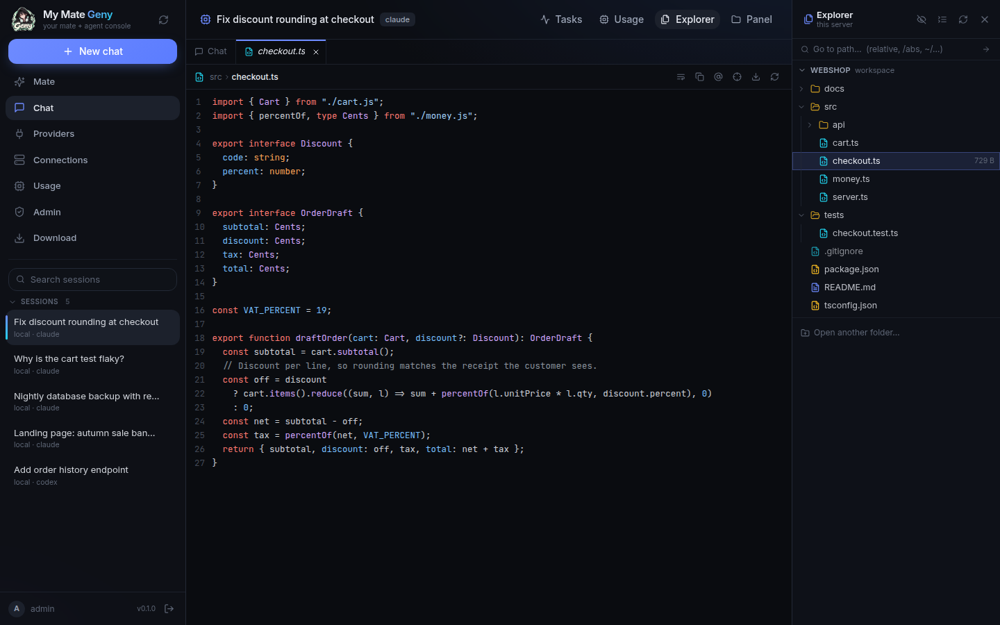
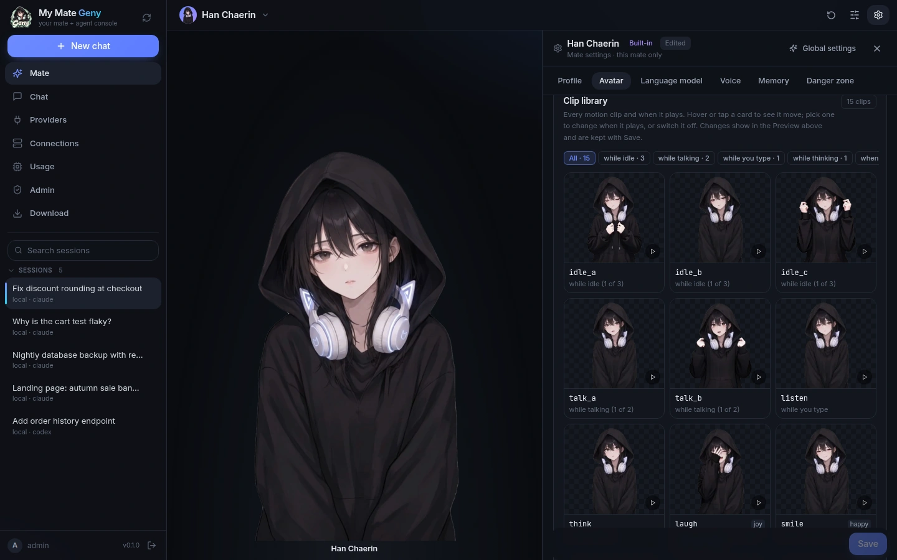
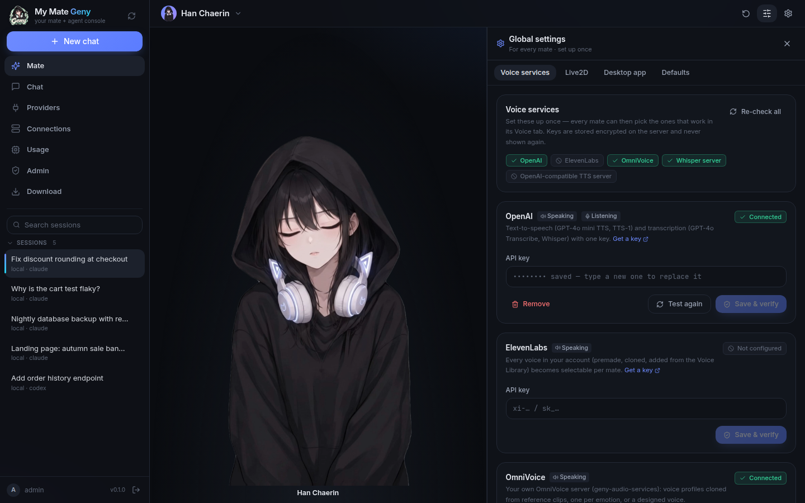
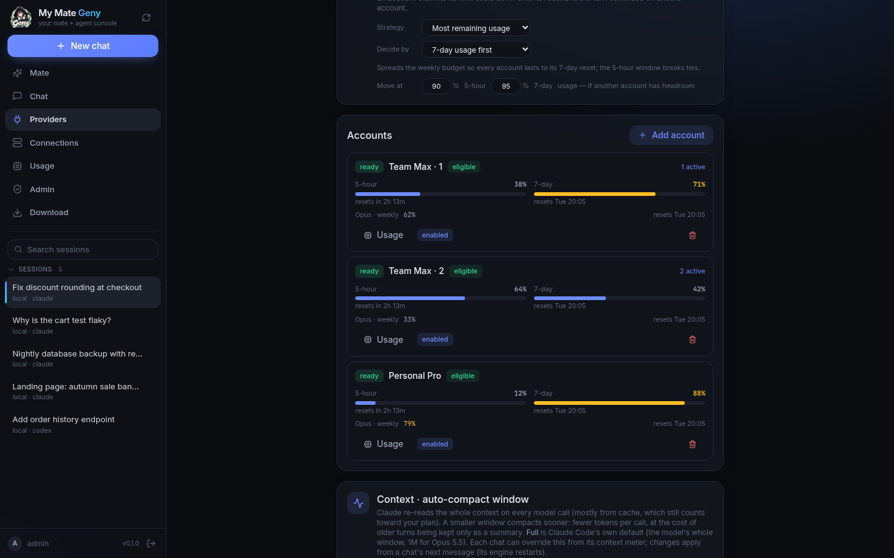
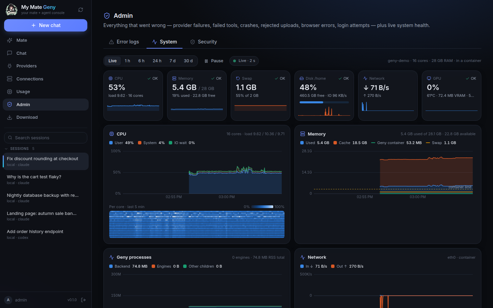
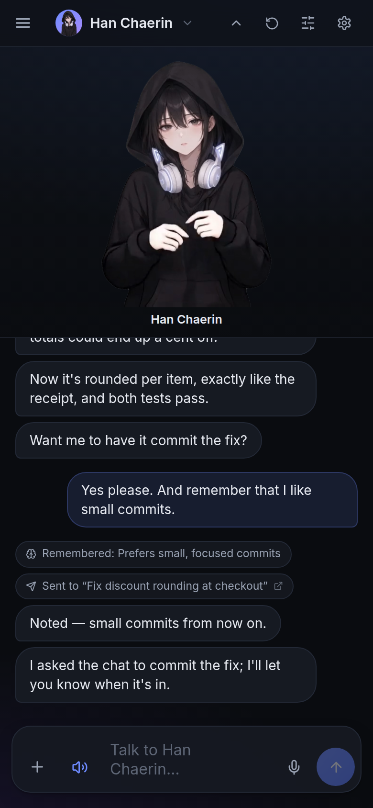

<p align="center"></p>

<h1 align="center">My Mate Geny</h1>

<p align="center">
  <b>Claude Code와 Codex를 내 서버에서 — 그리고 그 일을 대신 맡겨 주는 아바타 메이트.</b>
</p>

<p align="center">
  <a href="LICENSE"></a>
  
  
  
  
</p>

<p align="center">
  <a href="#빠른-시작">빠른 시작</a> ·
  <a href="#기능">기능</a> ·
  <a href="#메이트">메이트</a> ·
  <a href="#앱">앱</a> ·
  <a href="docs/">문서</a> ·
  <a href="README.md">English</a>
</p>

---

My Mate Geny는 **Claude Code**와 **Codex** CLI를 내 컴퓨터나 서버에서 돌아가는 채팅 서비스로
만들어 준다. 브라우저, 데스크톱 앱, 안드로이드 앱으로 접속해 로컬 폴더나 SSH 폴더에서 채팅을 시작하고,
도구 호출·서브에이전트·파일 변경을 하나하나 지켜보고, 여러 구독 계정에 부하를 나눈다.

채팅 위에는 **메이트**가 있다. 영상·사진·Live2D 몸과 목소리를 가진 캐릭터로, 필요한 일을 말하면
프로젝트를 찾아 채팅에 일을 맡기고, 진행을 챙기고, 결과를 알려 준다.

<p align="center">
  
</p>

| | |
|---|---|
|  |  |
| **메이트**: 말을 걸면 채팅에 일을 맡기고 결과를 보고한다 | **탐색기 + 뷰어**: workspace를 둘러보고 에이전트가 건드린 파일을 연다 |
|  |  |
| **메이트 설정**: 클립, 스틸, Live2D, 음성, 모델, 기억 | **전역 설정**: 음성 서비스와 Live2D 런타임을 한 번만 설정 |
|  |  |
| **Providers**: 계정 풀, 5시간 / 7일 사용량 기준 분산 | **Admin → System**: 호스트와 에이전트 실시간 모니터링 |

<p align="center">
  <br>
  <sub>휴대폰에서도 같은 콘솔(안드로이드 앱 또는 모바일 브라우저)</sub>
</p>

<sub>스크린샷은 일회용 서버의 데모 데이터이며, 사용량 수치는 가짜다.</sub>

## 기능

**콘솔: 진짜 코딩 에이전트와의 채팅**

- **엔진 둘, 채팅 하나.** Claude Code(`claude`)와 Codex(`codex`). 대화 중에 엔진을 바꿔도 맥락이
  넘어간다. Claude는 채팅마다 상주 엔진(후속 턴, 백그라운드 작업, 실시간 중단·모델·권한 전환),
  Codex는 턴마다 `exec` 한 번. 둘 다 하나의 이벤트 형식으로 스트리밍된다.
- **읽기 쉬운 에이전트 작업.** 본문과 도구 활동을 분리: 접히는 도구 묶음, 인라인 diff, 자기 단계가
  보이는 중첩 **서브에이전트**, 실행 중인 턴 조종, 메시지 대기열, `/` 명령과 `@` 파일,
  사진·파일·클립보드 첨부, 알림.
- **되돌릴 수 있는 변경.** 턴마다의 파일 변경을 git 스냅샷으로 기록하고, diff 뷰어와 파일별·턴별
  되돌리기를 제공한다.
- **백그라운드 작업.** 오래 걸리는 명령과 백그라운드 서브에이전트는 출력과 함께 작업 패널에 보이고,
  끝나면 Claude가 스스로 턴을 시작해 결과를 이어받는다.
- **탐색기와 뷰어.** VS Code 스타일 탐색기(로컬·원격)와 파일 탭: 코드, 마크다운, CSV/TSV, 엑셀, 워드,
  파워포인트, PDF, 노트북, HTML(샌드박스), 이미지·오디오·영상. 에이전트가 출력한 경로는 클릭하면 열린다.
- **컨텍스트 미터와 압축.** 컨텍스트가 얼마나 찼는지, Claude가 어디서 자동 압축할지, 채팅 안의 압축
  구분선을 보여 준다. 지금 바로 압축하거나, 자동 압축 창을 줄여 호출 비용을 아낄 수 있다.
- **Workspace.** 서버의 아무 폴더, SSH 호스트의 폴더(SSH 기반 MCP 브리지), 클론한 Git 저장소.
  채팅마다 추가 폴더도 붙일 수 있다.
- **계정 부하 분산.** 여러 Claude / Codex 로그인을 풀로 묶는다. 새 채팅은 여유가 가장 많은 계정으로
  가고, **5시간 창과 7일 창** 중 무엇을 기준으로 할지, 몇 %부터 "한도 근처"로 볼지 정할 수 있다.
  채팅은 자기 계정에 머물고(프롬프트 캐시), 한도에 걸린 계정은 쉬었다가, 한도에 막힌 턴은 다른
  계정에서 이어진다.
- **사용량.** 계정별 플랜 사용량(5시간, 주간, 모델별 주간), 턴·채팅마다의 API 환산 비용, 서버의
  토큰 합계.

**메이트**

- **몸**: 영상(대기·말하기·듣기·생각·감정 클립 상태 기계), 사진(눈 깜빡임과 입 모양 스틸),
  **Live2D**(Cubism 4/5). 답변 속 감정 태그로 움직이고 목소리에 맞춰 입을 움직인다.
- **음성 입출력**: 브라우저 음성(무료), OpenAI, ElevenLabs, OmniVoice(셀프 호스팅 음성 복제), 임의의
  HTTP TTS. 음성 인식은 Whisper 호환 서버 또는 OpenAI. 마이크를 누르고 말하면 된다.
- **위임**: 채팅 목록을 보고 읽고, 알맞은 폴더에 채팅을 열고, 진행 중인 채팅에 지시를 보내고, 결과를
  받아 보고한다.
- **기억**: 기억해야 할 것들(메이트가 직접 추가하기도 하고, 사용자가 고칠 수도 있다).
- **전역 설정 vs 메이트 설정**: 음성 서비스, Live2D 런타임, 데스크톱 옵션은 **Global settings**에서 한 번,
  프로필·아바타·언어 모델·음성·기억은 메이트마다 **Mate settings**에서.
- 내장 캐릭터 셋(한채린, 에스텔, 서아) 또는 직접 만든 메이트.

**앱 · 운영 · 보안**

- **데스크톱 앱**(Windows / macOS / Linux, Electron)과 **안드로이드 앱**(Capacitor). 둘 다 연결 화면에서
  시작한다: 서버 주소, 사용자 이름, 비밀번호. 앱은 내 서버의 콘솔을 불러오므로 UI 업데이트가 재설치
  없이 반영된다. 데스크톱에서는 메이트가 화면 위에 산다(투명, 항상 위; **Ctrl/Cmd+Shift+G** 빠른 채팅).
- **모니터링**: Admin → System에서 CPU, 메모리, 스왑, 디스크, 네트워크, GPU, 압력, 에이전트 프로세스와
  실행 중인 턴을 실시간 또는 최대 30일 기록으로 보고, 경고는 관리자 로그에 남는다. Admin → Error logs는
  프로바이더·도구·HTTP·클라이언트 오류를 모은다.
- **보안 모델**: 로그인 하나가 모든 것을 지킨다(콘솔도 그 뒤의 백엔드가 서빙). 서명되고 폐기 가능한
  세션, IP별 로그인 차단, vault에 암호화된 OAuth 토큰·API 키·SSH 키, 서버 자신의 자격증명은 파일 뷰어로
  절대 보여 주지 않는다. [보안](#보안) 참고.

## 빠른 시작

필요: Docker + Compose v2.24 이상, 이미지용 디스크 약 3 GB.

```bash
git clone https://github.com/CocoRoF/My-Mate-Geny.git
cd My-Mate-Geny
docker compose up -d
```

1. **http://localhost:8080** 을 열고 **`admin` / `geny-admin`** 으로 로그인한다.
2. 바로 로그인 정보를 바꾼다: **Admin → Security** ([docs/auth.md](docs/auth.md)).
3. **Providers** 에서 에이전트를 연결한다. 두 CLI 모두 이미지에 들어 있어 터미널이 필요 없다.
   - **Claude Code**: **Add account** → **Sign in**, 링크를 열어 승인하고 코드를 붙여 넣는다.
     계정을 더 추가하면 풀로 묶인다.
   - **Codex**: **Add account**, 기기 인증 링크를 열고 표시된 코드를 입력한다(또는 OpenAI API 키 저장).
4. 엔진, workspace, 폴더를 골라 채팅을 시작한다.

서버가 보관하는 모든 것(DB, 암호화된 vault, 계정 로그인, 메이트, 업로드, 클론한 저장소)은 `geny-home`
Docker 볼륨에 있다. 백업해 두고, 처음부터 다시 하려면 지우면 된다.

**작업 폴더.** 에이전트는 컨테이너 안 `/workspaces` 에서 일한다(기본은 Docker 볼륨). 호스트 폴더를
쓰려면 [.env.example](.env.example) 을 `.env` 로 복사해 `GENY_WORKSPACES=/path/to/projects` 와
`GENY_UID` / `GENY_GID`(폴더 주인의 `id -u` / `id -g`)를 적고 `docker compose up -d --build`.
원격 머신은 **Connections** → SSH 호스트 추가(키는 암호화 저장).

**호스트 로그인 재사용**(선택): 호스트에서 `claude` / `codex login` 을 한 번 실행한 뒤
[docker-compose.yml](docker-compose.yml) 의 `~/.claude`, `~/.claude.json`, `~/.codex` 마운트 주석을 푼다.

**운영 배포**: HTTPS를 앞에 두거나(Caddy, nginx 예시) Cloudflare 터널을 쓴다.
[docs/deploy.md](docs/deploy.md), [deploy/](deploy/) 참고. Docker 없이 돌리려면 `deploy/start-backend.sh`.

## 설정

- Compose 설정(포트, 바인드 주소, uid/gid, 작업 폴더, 쿠키 모드): [.env.example](.env.example),
  운영용 compose는 [deploy/.env.example](deploy/.env.example).
- 모든 백엔드 설정과 기본값·설명: [backend/.env.example](backend/.env.example)
  (`backend/.env` 로 복사).

꼭 설정해야 하는 것은 없다. 기본값만으로 동작하는 서버가 뜬다.

## 메이트

1. **Mate** 를 연다. 한채린이 바로 준비돼 있고, 에스텔과 서아는 메이트 선택 메뉴에 있다. 직접
   만들려면 **New mate**: 페르소나, 인사말, 답변 언어, 그리고 몸.
2. **음성.** 키와 서비스 URL은 **Global settings → Voice services** 에 한 번 넣고, 메이트마다
   **Mate settings → Voice** 에서 목소리를 고른다.
   - `browser`: 무료, 내장, 설정 불필요
   - `openai` / `elevenlabs`: API 키(암호화 저장)
   - `omnivoice`: [geny-audio-services](https://github.com/CocoRoF/geny-audio-services) 로 띄운 내 서버.
     내장 캐릭터에는 OmniVoice 목소리(참조 음성 또는 보이스 디자인)가 들어 있어 여기서 제 목소리로
     말한다. 모델 가중치는 비상업용 라이선스다.
   - `http`: OpenAI 호환 TTS 서버

   말로 대화하려면 Whisper 호환 STT URL을 넣는다(또는 OpenAI 키 사용).
3. **Live2D 런타임**(Live2D 몸에만 필요). Live2D의 Cubism Core는 재배포가 허용되지 않아 포함돼 있지
   않다. **Global settings → Live2D** 에서 Live2D 라이선스를 읽고 동의하면 서버가 live2d.com 에서 한 번
   내려받는다.
4. 프로젝트 일을 부탁해 본다. 메이트가 채팅을 열거나 재사용해 일을 맡기고 결과를 보고하며, 결과는
   그 채팅으로 이어지는 카드로 표시된다.

설계, API, 아바타 형식: [docs/mate.md](docs/mate.md).

### 내 아바타 넣기

**Mate settings → Avatar**(또는 **New mate → Import from the server**)에서:

- **영상 리그 팩**: `rig.json` 과 클립·스틸을 담은 zip(또는 서버 폴더). 대기·말하기·듣기·생각·감정용
  H.264 MP4 클립(투명 배경은 `stacked-alpha` 패킹)과 스틸 이미지. 어떤 클립이 언제 재생될지는 클립
  라이브러리에서 고친다. 형식: [docs/mate.md §2](docs/mate.md#2-avatar-three-kinds--none).
- **사진**: **Photo** 를 고르고 스틸을 올린다: `neutral` 과 감정들, 눈을 깜빡이고 말하게 하려면
  `blink`, `mouth_*` 프레임도.
- **Live2D**: 모델 zip을 올리거나 `*.model3.json` 이 있는 폴더를 입력한다(Cubism 4/5). geny-avatar
  내보내기는 `avatar-editor.json`(감정 매핑, 대기 모션, 탭 모션, 크기·위치)까지 읽는다. 그다음 감정별
  표정·모션을 지정한다.
- **Live2D 무료 샘플 모델**(Mao, Hiyori 등)은 라이선스상 재배포가 금지돼 포함하지 않는다.
  [Live2D 샘플 페이지](https://www.live2d.com/en/learn/sample/) 에서 약관에 동의하고 내려받아 위처럼
  zip을 가져오면 된다. 보여 주는 곳에는 *"This content uses sample data owned and copyrighted by
  Live2D Inc."* 크레딧을 표기해야 한다. 자세한 순서:
  [docs/mate.md](docs/mate.md#using-live2ds-free-sample-models).

## 앱

- 데스크톱 설치 파일과 안드로이드 APK는 콘솔의 **Download** 페이지나
  [GitHub Releases](https://github.com/CocoRoF/My-Mate-Geny/releases) 에서 받는다.
- 처음 실행하면 **연결 화면**에서 서버 주소(`example.com`, `192.168.0.10:8080`,
  `https://geny.example.com` 등), 사용자 이름, 비밀번호를 입력한다. 앱이 My Mate Geny 서버인지 확인하고
  로그인한 뒤 서버를 기억한다(비밀번호는 저장하지 않는다). 나중에 바꾸려면 **Server → Switch server…**.
- 앱은 *내* 서버의 콘솔을 감싸는 얇은 껍데기다. 자세히: [desktop/README.md](desktop/README.md),
  [mobile/README.md](mobile/README.md).
- **자체 앱을 배포하는 포크**: [.github/workflows/apps.yml](.github/workflows/apps.yml) 이 설치 파일과 서명된
  APK를 릴리스로 만들고, Download 페이지가 그 릴리스(`APPS_REPO` / `APPS_RELEASE_TAG`)를 읽는다. 앱 ID
  (`desktop/package.json` 과 `mobile/capacitor.config.json` 의 `appId`, `mobile/android/app/build.gradle` 의
  `applicationId` / `namespace` 와 Java 패키지)를 바꾸고, 안드로이드 서명 시크릿(`HRH_KEYSTORE_B64`,
  `HRH_KEYSTORE_PASSWORD`, `HRH_KEY_ALIAS`, `HRH_KEY_PASSWORD`)을 직접 만들고, `APPS_REPO` 를 내 저장소로
  지정한다. 원본 앱 ID는 기존 설치의 업데이트 연속성 때문에만 남아 있다.

## 보안

My Mate Geny는 **실제 셸**로 코딩 에이전트를 돌린다. 로그인할 수 있는 사람은 서버 사용자가 할 수 있는
모든 것을 에이전트에게 읽고, 바꾸고, 실행하게 할 수 있으니 로그인을 SSH 접속처럼 다룬다.

- 기본 로그인 `admin` / `geny-admin` 부터 바꾼다(Admin → Security).
- 포트는 localhost나 사설망에만 열어 두거나(빠른 시작은 127.0.0.1에 바인드), HTTPS를 앞에 둔다. 그러면
  세션 쿠키가 자동으로 `Secure` 가 된다.
- 권한 없는 사용자로 실행하고(이미지가 그렇게 한다) 에이전트에 필요한 폴더만 마운트한다.
- `~/.hr-harnessor/vault.key` 와 `session.key`(`geny-home` 볼륨 안)를 백업하고 보호한다.

에이전트는 채팅이 확인 창에서 멈추지 않도록 도구 권한을 미리 승인받은 상태로 돌며, 컨테이너 사용자가
곧 샌드박스다. 위협 모델, 알려진 한계, 취약점 제보 방법: [SECURITY.md](SECURITY.md).

## 개발

```bash
# 백엔드 (Python 3.11+)
cd backend
python3 -m venv .venv && . .venv/bin/activate
pip install -e '.[dev]'
cp .env.example .env                   # 선택: 모든 설정에 기본값이 있다
uvicorn app.main:app --reload --port 8080
pytest -q                              # 테스트 (실제 CLI 불필요)

# 웹 콘솔 (Node 22)
cd frontend
npm ci
npm run dev                            # http://localhost:5173, /api + /ws 를 :8080 으로 프록시
npx tsc -p . --noEmit                  # 타입 체크
```

실제 턴을 돌리려면 `claude` 와/또는 `codex` 가 `PATH` 에 있어야 한다
(`npm i -g @anthropic-ai/claude-code @openai/codex`). 기여 안내: [CONTRIBUTING.md](CONTRIBUTING.md).

## 구조

```
 웹 콘솔          데스크톱 앱 (Electron)        안드로이드 앱 (Capacitor)
        └──────────────────┬───────────────────────┘   REST + WebSocket (같은 origin)
                           ▼
        (HTTPS 프록시 / 터널) → FastAPI 백엔드: 콘솔, API, WS, 로그인
                           ├─ Engines       claude (상주) | codex (턴마다)
                           ├─ Accounts      CLI 로그인 풀, 분산
                           ├─ Workspaces    local | remote SSH (MCP 브리지)
                           ├─ Changes       턴별 git 스냅샷
                           ├─ Mate          페르소나, 음성, 아바타, 위임
                           ├─ Monitor       호스트·프로세스 샘플링, 경고
                           ├─ Vault         OAuth 토큰, API 키, SSH 키 (Fernet)
                           └─ Store         세션, 이벤트, 작업, 로그 (SQLite)
```

채팅 = **엔진 × workspace × 대화**. 자세히:
[구조](docs/architecture.md) · [프로바이더](docs/providers.md) · [원격 workspace](docs/remote.md) ·
[메이트](docs/mate.md) · [인증](docs/auth.md) · [모니터링](docs/monitoring.md) · [배포](docs/deploy.md)
(문서는 영어)

*(옛 이름 "hr-harnessor": 기존 설치가 그대로 업데이트되도록 `~/.hr-harnessor` 상태 폴더, 쿠키·저장소 키,
앱 ID 같은 내부 식별자는 그 이름을 유지한다.)*

## 기여 · 보안 · 라이선스

- [CONTRIBUTING.md](CONTRIBUTING.md): 변경 제안 방법.
- [SECURITY.md](SECURITY.md): 취약점 제보 방법(공개 이슈로 올리지 말 것).
- 코드: [Apache-2.0](LICENSE) ([NOTICE](NOTICE)).
- 내장 캐릭터(한채린, 에스텔, 서아)와 Geny 로고는 프로젝트 아트워크로 **모든 권리 보유**이며 Apache
  라이선스 대상이 아니다. 빌드를 배포하는 포크는 리브랜딩해야 한다: `assets/geny-logo.png`(정사각형 투명
  PNG)를 바꾸고 `python3 scripts/make-icons.py` 실행. 자세한 내용과 모든 서드파티 라이선스:
  [THIRD-PARTY-NOTICES.md](THIRD-PARTY-NOTICES.md).

My Mate Geny는 Anthropic, OpenAI, Live2D와 관계가 없다. Claude Code, Codex와 연결한 계정의 사용은 각
제공자의 약관을 따른다.

## 감사의 말

- 실제 일을 하는 엔진, [Claude Code](https://docs.anthropic.com/en/docs/claude-code)와
  [Codex CLI](https://github.com/openai/codex).
- Live2D 몸을 위한 [Live2D Cubism](https://www.live2d.com/),
  [PixiJS](https://pixijs.com/) 위의 [pixi-live2d-display](https://github.com/guansss/pixi-live2d-display).
- [FastAPI](https://fastapi.tiangolo.com/), [React](https://react.dev/), [Vite](https://vite.dev/),
  [Tailwind CSS](https://tailwindcss.com/), [Electron](https://www.electronjs.org/),
  [Capacitor](https://capacitorjs.com/).
- 메이트의 목소리를 위한 [OmniVoice](https://github.com/CocoRoF/geny-audio-services)와 Whisper 호환 서버.
- 내장 캐릭터는 Ailism 메이트 앱을 위해 만들어졌다.
