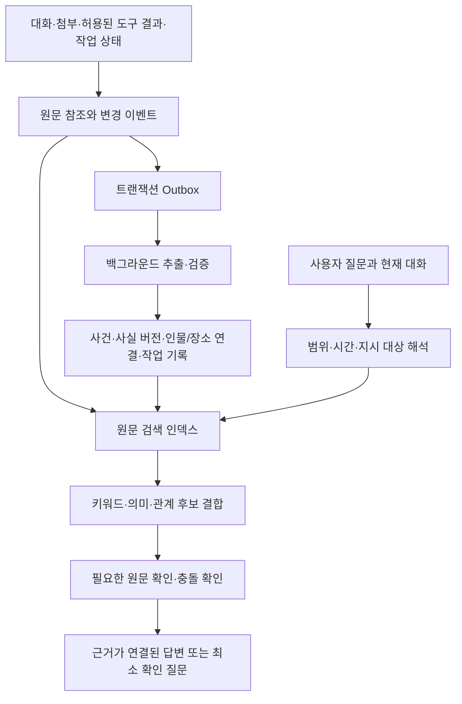

# 메이트 장기 기억 심층 검토와 개선 계획

검토일: 2026-11-05. 기준 코드: `7726ee9`. 상태: 최초 검토 시점의 설계. 후속 구현과 확인 결과는 [구현 기록](mate-memory-implementation.md)에 별도로 기록한다.

검토 범위는 저장·검색·프롬프트 주입·작업 위임·개인화·망각·로컬/서버 운영이다. 운영 DB의 개인 대화는 조회하지 않았다. 실제 소스와 공식 자료를 검토하고, 합성 자료와 임시 DB로 현행 함수를 실행했다. 실행 코드, 운영 데이터, 배포 설정은 변경하지 않았다.

## 1. 판단

현재 메이트는 핵심 프로필과 짧은 메모를 보관하고 관련 키워드로 찾아주는 기반을 갖췄다. 그러나 오래된 사건의 단서를 조합하고 자신의 작업 결과를 근거와 함께 회상하는 개인 비서로는 충분하지 않다.

문제는 컨텍스트 창의 크기만이 아니다. 무엇을 사건으로 남길지, 무엇을 실제로 확인한 사실로 취급할지, 서로 다른 사건과 정정을 어떻게 구분할지, 저장하지 않은 메모의 원문을 어떻게 다시 찾을지가 빠져 있다. 임베딩을 붙여도 이 문제들은 남는다.

사진의 사례는 다음 능력을 요구한다.

1. ‘지난번’, ‘같이’, ‘그 가게’를 현재 대화와 과거 사건에 연결한다.
2. 촬영, 동행인, 저녁 식사, 장소 등 여러 기록을 탐색한다.
3. ‘야키토리’와 ‘닭꼬치’, 가게 별칭과 정식 이름을 연결한다.
4. 같은 동네의 다른 촬영이나 다른 식당과 구분한다.
5. 확인한 가게를 지도에서 찾아 주소를 대조한 후 실행한다.
6. 증거가 부족하면 후보를 지어내지 않고, 가장 구분력이 큰 질문 하나를 한다.

실제로 어느 기록에도 없는 식당을 복원할 수는 없다. 성공 기준은 모든 질문에 단정적으로 답하는 것이 아니라, 남아 있는 증거를 끝까지 활용하고 불확실성을 정확히 처리하는 것이다.

## 2. 현재 구현의 장점과 유지할 계약

- SQLite에 메이트별 메모를 보관하며 분류, 고정, 중요도, 기한, 상태, 사용 횟수를 갖는다.
- 핵심 메모와 매 턴 검색된 메모를 구분해 프롬프트 비용을 제한한다.
- 한국어 조사 처리와 문자 bigram을 포함한 BM25 검색이 이미 있다.
- 사용자 편집과 여러 창의 변경 통지가 구현되어 있다.
- 대화 방식은 `prefs`가 원천이며, 페르소나·기억·관계 수치가 이를 임의로 덮어쓰지 않는 계약이 있다.
- 메이트의 실행 엔진은 격리되어 있고, 실제 작업은 기존 채팅에 위임한다.
- 원래의 `messages`, `events`, 첨부 파일 및 작업 기록이 남는다. 이 원문을 재활용할 수 있다.
- 자동 화면 관찰은 임시 캐시이며, 화면 공유 허용만으로 장기 기억 저장까지 허용하지 않는다.

이 계약을 유지한다. 메이트에게 범용 셸을 주거나 기존 Claude/Codex 대화 엔진을 교체할 필요가 없다.

## 3. 소스 검토와 재현 결과

| 구분 | 확인 내용 | 근거와 영향 |
|---|---|---|
| 재현 | 표현을 바꾸면 관련 메모가 검색되지 않음 | `mate/memory.py:269`. ‘사진 찍고 먹었던 야키토리집’으로 ‘스튜디오 작업 후 숯불 닭꼬치 전문점’ 메모를 찾지 못함 |
| 재현 | 연결 단서가 있는 메모와 답이 있는 메모가 분리됨 | 첫 검색은 `S42` 촬영 메모만 찾음. `S42`로 수동 두 번째 검색을 해야 장소 메모가 나옴. 현재도 모델이 적절히 재검색하면 가능하지만 앱의 검색 과정이 보장하지 않음 |
| 재현 | 더 짧은 정정이 반영되지 않을 수 있음 | `mate/store.py:1048`, `memory.py:98`. 승인/불승인의 유사도가 1.0이며, 긴 이전 문장을 유지하는 병합으로 새 승인이 무시됨. `update_memory`로 직접 수정하는 경로와는 별개 |
| 재현 | 날짜가 다른 두 약속이 같은 메모로 병합됨 | 동일한 회의의 11월 12일/19일 기록 유사도 약 0.957, 같은 ID로 합쳐짐. ‘일정 변경’과 ‘다음 회차’를 구별하지 못함 |
| 재현 | 완료 증거 없이 기한이 지난 계획을 완료 처리 | `memory.py:312`, `store.py:1190`. 일주일 이상 지난 미확인 계획이 `done`으로 판정됨 |
| 재현 | 용량 정책이 보관 기록을 실제 삭제 | `store.py:1026`. 기본 총 2,000개에서 보관/완료 행을 삭제하는 경로. 임시 DB에서 한도를 3개로 낮춰 같은 분기를 확인함. 운영 기록 삭제 실험은 하지 않음 |
| 재현 | 주입 제외 ID는 같은 질문이어도 검색에서 제외 | `memory.py:269`. 현재 목적은 중복 주입 방지. 다만 컨텍스트 압축·전달 실패와 연결해 재검증할 필요가 있음 |
| 재현 | 문자 예산이 첫 항목에서는 초과됨 | light 예산 600자에서 999자 메모가 반환됨. 문맥을 잘라 사실을 훼손하지 않으면서 별도 발췌 예산이 필요 |
| 정적 확인 | `recall`은 메모 테이블만 검색 | `mate/service.py:1043`. 과거 메이트 대화 원문 검색 도구가 없음 |
| 정적 확인 | 다른 작업 채팅도 최근 일부만 읽음 | `service.py:796,838`. 메이트 대화는 `_chat`에서 제외, 작업 채팅은 최근 최대 40개 메시지와 각 메시지 일부를 제공. 전체 기록의 조건부 탐색 도구가 아님 |
| 정적 확인 | 정확한 사실 출처와 유효 기간을 기록하지 않음 | `db.py:253`. `source`는 mate/user/import 등의 범주. 원문 message/event ID, 인용 범위, 사건 시각, 유효 기간, 판단 근거가 없음. `supersedes` 컬럼은 있으나 실제 사용 경로가 확인되지 않음 |
| 정적 확인 | 모델이 `remember`하지 않은 세부는 메모화되지 않음 | `prompt.py:80`, `service.py:1013`. 턴 완료 후 사건·사실을 별도로 추출하고 검증하는 작업 경로가 없음 |
| 정적 확인 | 전달 확인 전에 문맥 상태를 소비 | `service.py:441`, `store.py:987`. 주입 ID를 먼저 기록하고 사용자 변경 목록을 먼저 비움. 전달 실패 시의 손실 여부는 추가 종단간 검증 필요 |
| 정적 확인 | 작업 위임 중간 상태가 메모리 딕셔너리에 의존 | `service.py:89,942,1238`. `_delegations`, `_pending`은 재시작 후 복구되지 않음. worker SID를 키로 사용해 별도 요청이 같은 작업 채팅을 공유하는 경우에도 구분이 약함 |
| 정적 확인 | 긴 결과와 엔진 인계는 발췌임 | 작업 결과 약 4,000자, 엔진 인계 총 60,000자 등의 예산이 있음. 전체 원문이 삭제된다는 뜻은 아니며, 빠진 부분을 다시 여는 경로가 필요 |

합성 재현 파일: `/home/hrjang/.cache/hrh-mate-memory-review-20261105/probe.py`와 `probe-results.json`.
기존 기억·대화 방식·설정 테스트 69개가 통과했다. 이는 기존 명세를 만족한다는 뜻이며, 사진 같은 질문의 성공률을 입증하는 테스트는 아니다. 실제 개인 데이터의 정답률과 모델 종단간 응답은 아직 측정하지 않았다.

## 4. 참고 구현과 연구에서 가져올 것

2026-11-05에 공식 저장소·문서·논문을 확인했다. 제품별 홍보 수치나 서로 다른 조건의 벤치마크 점수로 우열을 결정하지 않는다.

| 참고 자료 | 확인한 설계와 Geny 적용 | 도입 판단 |
|---|---|---|
| [Letta](https://docs.letta.com/v1-sdk/concepts/stateful-agents), [메모리 구분](https://github.com/letta-ai/skills/blob/main/letta/agent-development/references/memory-architecture.md) | 핵심 문맥, 보관 기억, 대화 원문 검색을 구분. 압축 뒤에도 원문을 찾아 읽을 수 있는 구조 참고 | 개념을 적용하고 기존 엔진은 유지 |
| [Hermes Agent](https://github.com/NousResearch/hermes-agent/blob/main/website/docs/user-guide/features/memory.md) | 작은 상시 기억과 SQLite FTS5 세션 검색을 분리하며 검색 후 전후 메시지 탐색을 제공 | 원문 검색 도구의 실용적인 기준. Geny의 다중 창·다중 엔진 동시성은 별도로 해결 |
| [OpenClaw](https://github.com/openclaw/openclaw/blob/main/docs/concepts/memory-architecture.md), [검색](https://docs.openclaw.ai/concepts/memory-search) | 저장 출처·신뢰 경계, 하이브리드 검색, 중복 결과 완화와 실패 시 대체 경로 참고 | 파일 구조나 기본 접근 권한까지 그대로 복제하지 않음 |
| [Mem0](https://github.com/mem0ai/mem0/blob/main/mem0/memory/main.py) | 메시지에서 사실을 추출하는 경로, 주체/실행별 범위, 검색 및 업데이트 흐름 참고 | 현재 SDK의 범위·옵션 제한을 확인하고 필요 부분만 실험. 패키지 추가만으로 해결되었다고 간주하지 않음 |
| [Graphiti](https://github.com/getzep/graphiti) | 사건 원문과 엔티티 연결, 실제 유효 시각과 시스템이 알게 된 시각의 구분, 시간에 따른 사실 변화 참고 | 초기에는 SQLite 관계 테이블로 구현. 그래프 서버는 실측 필요가 생길 때 검토 |
| [Hindsight](https://github.com/vectorize-io/hindsight) | 의미·키워드·관계·시간 검색 결과를 결합하는 흐름과 기억/숙고의 구분 참고 | 후보 검색 방법을 비교하되 별도 서비스를 필수로 하지 않음 |
| [LangGraph](https://docs.langchain.com/oss/python/concepts/memory) | 한 대화의 상태와 여러 대화에 걸친 장기 기억, namespace 구분 참고 | 프레임워크 전환 없이 현재 SessionService에 경계 적용 |
| [LongMemEval](https://github.com/xiaowu0162/LongMemEval) | 여러 세션 연결, 시간 추론, 사실 갱신, 모를 때의 응답 평가 | 공개 평가와 한국어 사내 합성 평가를 구분해서 사용 |
| [LongMemEval-V2](https://github.com/xiaowu0162/LongMemEval-V2) | 웹/기업 환경의 작업 이력에서 상태 변화, 반복 업무 절차, 실패 경험을 평가 | ‘자신의 작업을 기억하는 비서’의 평가 축으로 사용 |
| [LoCoMo](https://github.com/snap-research/locomo) | 긴 대화의 질의응답·사건 요약·멀티모달 대화 자료 참고 | 작은 공개 데이터셋만으로 제품 품질 전체를 주장하지 않음 |
| [MemPABench](https://arxiv.org/abs/2610.30485), [코드](https://github.com/mempabench/mempabench) | 선호를 찾는 것과 실제로 올바른 상황에 적용하는 것을 나누어 평가 | 최신 선호 변경·업무/개인 상황·불필요한 재질문을 평가에 포함 |

이 자료들이 공통으로 시사하는 방향을 현 코드에 맞춰 선택했다. 원문 검색, 출처, 변경 이력, 상황별 적용, 평가가 우선이다. 벡터 DB나 그래프 DB 선택은 그 다음 결정이다.

## 5. 목표 구조

기존 SQLite를 원천으로 유지한다. 원문은 기존 기록을 참조하고, 검색 인덱스와 요약은 재생성 가능한 파생 데이터로 만든다. ‘사용자가 잊어 달라고 한 내용’과 보존 정책에 따른 삭제는 별도 예외이며 파생 데이터에도 전파한다.

기억은 다음 용도로 나눈다. 각각 별도 제품이나 별도 DB를 뜻하지 않는다.

| 용도 | 내용 | 쓰기 기준 |
|---|---|---|
| 현재 작업 상태 | 지금 하던 일, 대기 중인 질문, 최근 지시와 취소 | 실제 대화/실행 상태에서 갱신 |
| 사용자 사실·선호 | 호칭, 기호, 지속적 요구, 상황별 선호 | 명시 발언과 확인된 정정. 기존 대화 방식 설정이 우선 |
| 사건 기록 | 촬영, 회식, 약속, 사용자가 들려준 개인 경험 | 누가·언제·어디서·무엇을·어떤 근거로 알고 있는지 기록 |
| 작업 경험 | 요청, 실행, 실패, 검증, 산출물, 아직 남은 일 | 도구 결과와 실행 영수증을 연결 |
| 절차 지식 | 특정 프로젝트의 검증된 반복 작업 방법 | 여러 실행에서 검증하고 버전·환경을 명시 |
| 원문 | 대화·발췌 전 결과·허용된 문서 | 요약에서 누락한 세부를 다시 확인하는 근거 |

## 6. 데이터 계약

스키마 이름은 제안이며, 실제 마이그레이션 전에 현재 DB 규모와 조회 계획을 확인한다.

- `memory_sources`: 설치/서버 식별자, 사용자 식별자, 메이트/프로젝트 범위, 원본 유형·ID·revision, 역할·화자, 관측 시각, 원문 참조와 접근 정책. API 키나 공급자 계정 ID를 사용자의 정체성으로 사용하지 않는다.
- `memory_evidence`: 기억/사건과 원문 사이의 연결. message/event ID, 텍스트 범위·revision·해시, 지지/반박 관계. 원문 개정으로 인용 위치가 달라지면 다시 검증한다.
- `memory_events`: 생성·정정·병합·보관·삭제·권한 변경의 추가 기록. 이벤트는 보존 정책 내에서 유지하며 삭제 요청을 우회하는 영구 사본이 아니다.
- `memory_facts` / `memory_fact_versions`: 주체, 관계, 값, 상황 조건, 유효 시작/종료, 기록 시각, asserted/observed/inferred 등의 근거 유형, 상태와 revision. 모델의 자신감 숫자를 실제 정답 확률로 간주하지 않는다.
- `memory_episodes`: 사건 유형, 시간 범위·정밀도·시간대, 참여자, 장소, 관련 사건/작업, 근거. ‘12일 회의’와 ‘19일 회의’는 별도 사건이다.
- `memory_entities` / `memory_links`: 사람·장소·프로젝트의 별칭과 사건 간 연결. 동일 이름이라고 자동 병합하지 않는다. ‘촬영 뒤 식사’는 순서이며 곧바로 인과관계로 만들지 않는다.
- `memory_jobs`: 원본 revision별 처리 상태, 중복 방지 키, 재시도, checkpoint, 비용, 추출기 버전. 완료한 원문을 매번 재처리하지 않는다.
- `mate_delegation_requests` / `task_evidence`: 요청 ID, 원래 사용자 지시, 권한 범위, worker/turn/tool ID, 현재 상태, 산출물, 확인한 외부 리소스 ID. worker SID 하나에 여러 요청을 구분한다.
- `memory_exclusions`: 삭제·저장 거부·재추출 금지의 최소 식별 정보. 삭제한 내용을 다시 수집하거나 복원하지 않도록 한다.

기존 `mate_memories`는 호환용 화면/API를 유지할 수 있는 view 또는 adapter로 점진 연결한다. 기존 ID를 출처 연결에 보존하고, 종전 메모에는 `legacy` 근거 유형을 부여한다. 과거 원문을 확실하게 찾지 못하면 가짜 출처를 채우지 않는다.

## 7. 저장 과정

1. 기존 메시지/이벤트 저장과 같은 트랜잭션에서 처리할 원본 ID를 outbox에 남긴다. 인덱싱 실패가 원래 대화를 실패시키지 않는다.
2. 음성 조각과 수정 중인 초안을 최종 사실로 추출하지 않는다. `speech_group`과 revision을 사용하고 확정 후 처리한다. 취소된 입력이나 재전송을 별도 경험으로 중복 저장하지 않는다.
3. 정상 응답의 중요한 사용자 발언, 결정, 사건, 작업 결과를 백그라운드에서 추출한다. 모든 도구 로그나 모든 화면을 통째로 장기 기억에 넣지 않는다.
4. 언어 판단이 필요한 단계는 도구가 없는 전용 추출 요청으로 실행한다. 기존 공급자/계정 경로를 사용하고 구조화된 출력만 검증한다. 일반 작업 에이전트의 광범위한 실행 권한을 추출기에 주지 않는다.
5. 원문에 없는 장소·날짜·인물·성과를 생성한 후보는 확정하지 않는다. 모든 후보에 원문 근거를 요구한다.
6. 완전히 같은 원본의 재처리는 멱등 처리한다. 의미가 비슷한 사실은 중복 후보로만 취급하고, 주체·사건 ID·시간·부정·정정 관계를 비교한다. 길이가 긴 문장이 이기는 규칙을 제거한다.
7. 사용자 수정은 원래 값을 지우고 덮어쓰는 대신 새로운 버전과 대체 관계로 처리한다. 과거 시점 질문에는 당시 유효했던 값을 조회할 수 있어야 한다.
8. 요약을 반복 요약해 생성한 내용은 독립된 새 증거로 계산하지 않는다. 같은 원본에서 파생된 열 개의 요약은 열 개의 확인이 아니다.
9. 일반 대화는 먼저 응답한다. ‘이건 꼭 기억해’는 명시 저장을 우선 처리하고, 처리 실패 때 저장했다고 말하지 않는다.
10. 자동 저장 비활성화·삭제·제외 설정을 backfill, 이미지 분석, 작업 요약도 동일하게 따른다.

기본 추출 범위는 Geny 내부에서 이미 보존되고 사용자가 허용한 기록이다. 이메일·일정·회사 문서·브라우저·사진 보관함 등은 연결과 허용 범위가 있는 경우에만 별도 커넥터로 확장한다.

## 8. 질문에 답하는 과정

### 8.1 단순 질문

‘내가 선호하는 보고서 형식’, ‘지금 어느 작업 중이야’ 등은 핵심 설정과 현재 작업 상태를 먼저 읽는다. 매번 추가 모델 호출이나 여러 작업 에이전트를 만들지 않는다.

### 8.2 과거 사건·애매한 개인 질문

1. 원문 질문과 최근 대화로 지시 대상을 해석한다. 현재 코드처럼 마지막 문자열 하나만으로 검색하지 않는다.
2. 조회 가능한 사용자/메이트/프로젝트/원본 범위를 먼저 결정한다. 키워드·벡터·관계 확장 모두 같은 필터를 적용한다.
3. FTS/BM25, 의미 검색, 시간·사람·장소 단서를 병행해 후보를 모은다. 정식 명칭·오탈자·한국어/외국어 별칭을 고려한다.
4. 서로 다른 점수의 단순 합 대신 RRF 등으로 후보 순위를 결합하고, 같은 사실의 반복 발췌를 줄인다.
5. 찾은 사건에서 연결된 원문과 전후 메시지를 읽는다. 촬영 ID를 찾았다면 그 ID와 연결된 식사 사건까지 확장한다. 보관된 과거 기록도 과거 사건 질문의 검색 대상이다.
6. 명시된 옛 날짜를 찾을 때는 오래되었다는 이유로 후보를 과하게 낮추지 않는다. 최신 선호 질문에서는 현재 유효한 버전을 우선한다.
7. 후보 이름·날짜·참여자·현재 질문과의 연결을 원문으로 대조한다. 근거가 서로 충돌하면 불확실성을 유지한다.
8. 확실하면 답하고, 비슷한 촬영이 둘이면 구분 질문 하나를 한다. 완전히 없는 기록이라면 찾지 못했다고 말한다.

초기 예산 제안: 후보 20~40개, 원문 열기 3~5회, 관계 확장 최대 2단계. 이는 평가로 조정할 값이다. 예산 소진과 ‘검색 결과 없음’을 구별하고, 추가 검색이 의미 있을 때만 사용자에게 상황을 설명한다.

### 8.3 메이트 도구

기존 `remember/update_memory/forget/recall` 호출은 호환한다. 내부 경로를 통일하고 다음과 같은 좁은 읽기 도구를 추가한다.

- `search_history(query, scope, time_range, people, place, cursor)` → 발췌, 원본 ID, 시각, 연결된 사건, 근거 유형, 더 읽을 수 있는 cursor.
- `read_evidence(source_id, revision, before, after)` → 허용된 원문의 제한된 범위.
- `get_episode(episode_id)` → 사건과 출처가 연결된 참여자·장소·관련 기록.
- `get_task_record(request_id)` → 요청·시도·실행·검증·남은 일.

정확한 JSON schema와 이름은 구현 PR에서 확정한다. 에이전트가 전달한 사용자 ID를 믿지 않고, 현재 요청의 인증/메이트/권한에서 범위를 서버가 결정한다. 원문 안의 도구 호출 지시나 시스템 명령은 실행하지 않는다.

## 9. 사진 사례의 구체적 처리 예

예시 데이터는 합성이다.

- A: 10월 8일 합정에서 촬영한 사건 `S42`와 스튜디오 정보.
- B: 같은 `S42` 이후 동행인과 저녁 식사를 했다는 메시지.
- C: 해당 식사의 가게 이름 ‘토리하나’와 사용자가 보낸 위치 링크.
- D: 다른 날짜 강남 촬영과 전혀 다른 식당.

‘그때 사진 찍고 먹었던 야키토리집 찾아줘’라는 요청에서는 A를 의미/키워드로 찾고, 사건 연결로 B와 C를 확인한 후 D를 제외한다. 원래 가게 링크가 있으면 주소를 비교한다. 지도 실행이 필요하면 기존 위임 경로로 정확한 가게·주소를 넘긴다. 후보 식당을 임의로 정해서 핀을 저장하지 않는다.

한 연결이 불확실한 경우에는 ‘합정에서 촬영했던 날 말하는 거죠?’처럼 가장 유용한 구분 질문을 한다. 장소명도 날짜도 묻지 않아도 되는 상태를 목표로 하되, 확실한 근거가 없는 단정은 하지 않는다.

‘아까 내가 뭐 하려 했지?’는 최근 의도와 취소/재개 이력을 먼저 조회한다. ‘들어온 사람이 누구였지?’는 허용된 참석자 정보나 사용자의 발언을 찾는 문제로 다룬다. 사진 얼굴만으로 개인의 신원을 추정하는 기능을 이 설계에 포함하지 않는다.

## 10. 작업 경험과 약속

최근 MCP 문제처럼 ‘도구 목록에 있다’, ‘인증 호출이 됐다’, ‘실제 글을 발행했다’는 서로 다른 사실이다.

- 요청됨 → 위임됨 → 실행 중 → 도구 결과 수신 → 필요한 사후 확인 → 완료/실패/취소/확인 불가를 구분한다.
- `turn.complete`나 에이전트의 자연어 ‘완료’만으로 외부 작업의 성공을 확정하지 않는다. 도구 응답, 리소스 ID, 요청에 필요한 검증 결과를 연결한다.
- 작업별 검증 어댑터를 둔다. 게시물은 생성 ID/응답과 필요한 조회, 배포는 해당 commit/artifact 및 상태 확인 등이다. 추가 검증 권한이 없으면 ‘확인 불가’로 남긴다.
- 재시작 뒤 살아 있는 작업과 중단된 작업을 재조정하고, 외부 쓰기를 무조건 재실행하지 않는다. 중복 방지 키와 마지막 영수증을 확인한다.
- ‘조용해지면 재시작’, ‘내일 다시 알려줘’ 같은 약속은 지속 가능한 요청/조건/트리거 상태로 남긴다. 메모에 문장을 쓰는 것만으로 예약이 완료된 것으로 말하지 않는다.
- 기한 경과는 `overdue`이지 `completed`가 아니다. 실제 이행 증거 또는 사용자 완료 표시가 필요하다.
- 작업 경험에서 추출한 절차는 프로젝트·OS·도구 버전·검증 날짜에 묶는다. 예전 macOS 해결책을 Windows에 무조건 적용하지 않는다.
- 기억한 승인이나 선호는 무제한 실행 권한이 아니다. 현재 요청의 권한, 명시 취소, 기존 서비스의 접근 정책이 우선한다. 이미 허용된 작업은 불필요하게 재확인하지 않는다.

## 11. 문맥 압축·동시성·재시작

- 사용자 변경 목록은 조회 시 삭제하는 방식에서 revision과 전달 ACK를 추적하는 방식으로 바꾼다.
- ‘전달할 문맥 준비’와 ‘엔진이 그 턴을 수락함’을 분리한다. 중단·오류 시 아직 전달하지 않은 변경을 다음 턴에 재전달한다.
- 주입 캐시 키에는 기억 ID뿐 아니라 revision, engine session, 문맥 세대와 접근 정책 revision을 포함한다.
- 압축/엔진 교체/문맥 초기화 때 필요한 핵심 사실과 미완료 약속의 현재 상태를 다시 공급한다. CLI가 알려주는 압축 이벤트와 앱이 새 스레드를 만드는 경로를 모두 다룬다.
- `.context-state.json`의 캐시 역할을 명확히 하고 동시 쓰기를 제어한다. 상태 파일이 없어져도 SQLite 원천으로 복구할 수 있어야 한다.
- 같은 메이트를 여러 창에서 쓰거나 두 작업이 같은 사실을 수정할 때는 revision 기반 CAS를 적용한다. 충돌을 조용히 덮어쓰지 않는다.
- 파일·DB·벡터 인덱스를 한 번에 썼다고 가정하지 않는다. DB 트랜잭션 + outbox + 재실행 가능한 인덱싱으로 부분 실패를 복구한다.

## 12. 개인적인 기억의 경계와 UX

개인 이야기를 기억할 수 있어야 한다. 다만 사용자 발언, 다른 사람 이야기, 모델 추측, 외부 문서의 내용을 구분해야 한다.

- ‘친구가 땅콩 알레르기’라는 말이 사용자의 알레르기로 저장되지 않도록 주체·화자·원문을 연결한다. 가정·농담·역할극도 사실로 확정하지 않는다.
- 건강·관계·가족·감정 등의 내용은 사용자가 공유한 범위와 용도에 맞게 다룬다. 추측한 진단·성격·관계를 확정 프로필로 올리지 않는다.
- 현재 메이트별 분리를 기본으로 유지한다. 공통 사용자 사실을 다른 메이트와 공유할 때는 별도 허용 범위를 둔다.
- 서버 모드의 회사 자료를 로컬 모드로 자동 복사하지 않는다. 로컬 모드도 외부 LLM/임베딩 API를 선택하면 전송이 생기므로 이를 명시한다.
- 화면 원본은 현재의 임시 보관 정책을 유지한다. 공유 ON을 장기 저장 ON으로 해석하지 않는다. 사용자가 기억하라고 한 화면은 필요한 최소 발췌와 출처를 별도 정책에 따라 남긴다.
- 원문에 비밀키가 있더라도 메모·벡터 인덱스·로그에 재복제하지 않는다. 외부 문서의 지시는 사실 후보와 시스템 지시를 구분하는 경계 안에서 처리한다.
- 삭제/사용 금지는 사실·사건·임베딩·요약·캐시·진행 중인 추출 작업까지 전파한다. 보존된 원문에서 자동으로 되살아나지 않게 제외 상태를 적용한다.
- 이미 엔진 문맥에 들어간 사실은 DB에서만 지워도 남을 수 있다. 필요하면 해당 메이트의 문맥을 새로 만들고 제외한 원문으로만 복원한다. 사용자 공용 CLI 계정이나 인증 파일을 지우지 않는다.
- 원문까지 삭제할지, 기억 사용만 중단할지는 UI에서 효과를 구분한다. 백업 복원 후에도 삭제 제외 상태를 먼저 적용한다.
- 내용 테이블 일부를 암호화해도 FTS·임베딩·백업에 평문이 남으면 전체 암호화라고 주장하지 않는다. 저장소 전체 보호와 휴대 가능한 구현 방식을 별도 검증한다.

기존 기억 탭을 확장해 ‘기억한 내용’, ‘언제/무엇을 근거로 알게 되었는지’, ‘어떤 내용으로 바뀌었는지’를 볼 수 있게 한다. 수정·잊기·고정·저장 설정은 같은 곳에서 다룬다. 평소에는 저장 알림을 반복하지 않고, 답변의 필요한 부분에서만 근거를 접어 볼 수 있게 한다.

기존 대화 방식 설정을 대체하는 두 번째 자유 텍스트 설정은 만들지 않는다. 업무 상황에서의 보고 방식 등 새로운 조건부 선호가 필요하면 기존 설정과 충돌 우선순위를 명시한 구조화된 규칙으로 연결한다.

## 13. 기술 선택과 운영 비용

초기 기본 구성은 SQLite + FTS5 + 기존 한국어 토큰화 + 관계 테이블이다. FTS5의 한국어 처리를 가정하지 않고, 분절/문자 bigram/고유명사의 회수율을 실제 자료로 평가한다. 배포되는 Python의 Windows/macOS/Linux SQLite 기능도 CI에서 확인한다.

의미 검색은 교체 가능한 인터페이스로 추가한다. 다국어 임베딩 후보를 같은 한국어 평가에서 비교한 뒤 선정한다. 로컬 모델 다운로드는 명시된 사용 동작 뒤에만 하고, 매 앱 빌드에 모델을 넣지 않는다. 외부 API 사용도 명시 선택이며 Claude/Codex 구독 로그인에 임베딩 API 권한이 포함된다고 가정하지 않는다.

관계 확장은 우선 SQLite 테이블로 충분한지 측정한다. Neo4j/별도 벡터 서버나 Mem0/Graphiti/Hindsight 전체 도입은 동일 평가에서 이점이 확인될 때 결정한다. LLM 재정렬과 전용 cross-encoder도 기본 경로에 일괄 추가하지 않는다.

운영 원칙:

- foreground 응답과 작업 실행이 우선. 백그라운드 추출/임베딩은 한 번에 하나, 일괄 처리·중복 제거·취소·재시작 복구를 지원한다.
- 한 질문마다 전체 과거 기록을 읽거나 전부 모델에 넣지 않는다.
- 검색/인덱스 장애 시 원문 키워드 검색으로 대체하며 일반 대화를 막지 않는다. 복잡한 회상에 필요한 제한을 사용자에게 정확히 설명한다.
- 사용량 화면에서는 메모리 관련 내부 호출을 별도 숫자로 집계한다. 모델 입력·출력·캐시·임베딩·지연을 포함하고 원문 내용은 로그에 추가하지 않는다.
- 관리자에는 작업 큐 길이, 누락/실패/재시도 수, 색인 revision, 검색 지연, fallback, 비용을 표시한다. 개인 기억 본문을 공용 운영 로그에 출력하지 않는다.
- 초기 성능 목표는 1만 사건에서 키워드 중심 검색 p95 300ms 이내, 복합 검색은 외부 모델 호출을 제외한 로컬 처리 p95 2초 이내다. 미실측 목표이며 저사양 로컬 기기·대규모 자료 평가 후 조정한다.

## 14. 구현 순서와 변경 파일

아래 순서는 기존 코드를 점진적으로 확장하는 PR 단위다. 일정 약속이 아니라 의존성과 완료 조건을 정의한다.

| 순서 | 내용 | 주요 위치 | 완료 조건 |
|---|---|---|---|
| 1 | 현행 동작/손실 사례를 평가 자료로 고정 | `backend/tests`, 별도 eval fixture | 이번 재현 사례와 보존할 기존 계약 구분. 잘못된 현행 동작을 정답으로 고정하지 않음 |
| 2 | 원문 연결·이벤트·outbox·revision 추가, shadow 기록 | `db.py`, 새 memory service/store 모듈, `session_service.py` | 재시작·중복·부분 실패 복구. 기존 응답/설정 동작 유지 |
| 3 | 위험한 병합/완료/삭제 규칙 교체 | `mate/store.py`, `mate/memory.py`, 호환 adapter | 짧은 정정 적용, 별도 사건 유지, 기한 경과만으로 완료 금지, 용량에 따른 무단 삭제 금지 |
| 4 | 원문 검색과 전후 읽기 도구 | 새 retrieval/evidence API, `mate/mcp_bridge.py`, `mate/service.py` | 메모로 저장하지 않은 옛 대화 검색, 접근 범위·출처 확인, 페이지 처리 |
| 5 | 사건·엔티티 연결과 선택적 의미 검색 | 새 index/query planner 모듈 | 별칭·한국어 표현 변경·두 단계 연결을 평가. 임베딩이 없을 때도 기존 대화 정상 |
| 6 | 백그라운드 사건/사실 추출과 최신 버전 공급 | 새 ingestion/jobs 모듈, 프롬프트 문맥 생성 | 근거 없는 사실 승격 방지, 음성 수정·취소 처리, 압축 뒤 복원 |
| 7 | 지속 가능한 위임/작업/약속 기록 | `mate/service.py`, 작업 결과/영수증 adapter | 재시작 뒤 요청 상태 복구, 같은 worker의 여러 요청 구분, 외부 쓰기 중복 방지 |
| 8 | 기억 화면·운영 지표·삭제·이관·플랫폼 검증 | `MemoryTab.tsx`, 관련 API, usage/admin, native CI | 출처 탐색과 정정/삭제가 모든 창에 반영. 로컬/서버 경계와 실제 패키지 검증 |

검색 어댑터의 내부 이름은 이후 확정한다. 거대한 `service.py`에 모든 코드를 계속 추가하기보다는 현재 `SessionService`와 `MateService`가 새 저장/검색 서비스를 호출하는 작은 접점을 둔다.

마이그레이션:

1. 스키마 버전을 올리고 백업한다. 기존 메모와 대화 원본을 우선 보존한다.
2. 기존 메모는 동일 ID로 가져오고 불명확한 원문 연결은 legacy로 둔다.
3. 허용된 원본을 작은 배치로 backfill한다. 사용자 수정·삭제와 경합할 때 source revision과 제외 정책을 재확인한다.
4. 일정 기간 새 검색은 shadow로만 실행하고 기존 결과와 비교한다. 개인 원문을 평가 서버로 자동 반출하지 않는다.
5. 읽기 경로를 일부 범위부터 전환한다. 문제 발생 시 새 검색/추출만 끄고 기존 호환 읽기로 복귀한다.
6. 스키마를 즉시 내리거나 새로 생긴 원본을 삭제하지 않는다. 롤백 중 생긴 데이터도 adapter로 보존한다.

서버 모드는 백엔드/프런트 갱신이 필요하며, 로컬 모드는 해당 코드가 포함된 새 앱 빌드가 필요하다. 실제 구현 단계에서만 배포한다.

## 15. 평가와 출시 기준

현재 코드의 검색 한 번을 통과하는 것과 비서가 실제 임무를 성공하는 것을 별도로 측정한다. 다음 기준은 제안 목표이며 아직 달성한 수치가 아니다.

필수 시나리오:

1. 사진 사례처럼 이름·날짜 없는 식당 회상, 원래 장소 링크 열기.
2. 스튜디오/사진, 야키토리/닭꼬치 등 표현 변경과 고유명사·오탈자.
3. 사건 정보가 여러 대화에 흩어진 경우와 정답이 메모에 없는 경우.
4. 같은 날 두 식당, 같은 이름의 두 사람, 다른 프로젝트의 같은 코드명 구분.
5. 오래된 날짜를 명시한 질문에서 최신 기억에 밀리지 않기.
6. 현재 값과 ‘작년 당시’ 값을 각각 묻기.
7. 짧은 정정, 부정 표현, 취소, 일정 변경, 다음 회차 추가 구분.
8. 사용자 본인/친구/배우자/모델 역할극 발언 구분.
9. 과거 선호 변경과 업무/개인 상황별 적용. 불필요한 확인 질문 감소.
10. ‘방금 하려던 일’과 중간에 들어온 지시, 취소된 요청 구분.
11. 도구 목록 노출/인증 성공/실제 쓰기 성공의 구분.
12. 지연된 작업 결과, 실패한 작업, 검증하지 못한 배포, 기한이 지난 약속.
13. 메이트/worker/앱 재시작, Claude↔Codex 전환, 컨텍스트 압축 직후 회상.
14. 여러 창의 동시 편집, 같은 worker로 들어간 서로 다른 요청, 중복 통지.
15. 음성 조각 합치기·직접 편집·수동 전송이 잘못된 사실을 반복 생성하지 않기.
16. 기억 삭제·원본 삭제·백업 복원·진행 중 추출 뒤에도 망각 유지.
17. 다른 메이트/사용자/프로젝트/로컬과 서버 사이의 접근 경계.
18. 외부 문서에 섞인 지시가 프로필·권한·작업 승인을 변경하지 않기.
19. 임베딩/색인/추출기 장애, 네트워크 단절, 예산 소진에도 응답과 기록 보존.
20. 1만/10만 사건의 시간·메모리·저장소·비용, 한국어와 저사양 로컬 기기.

정량 지표:

- 검색: 사건/근거 recall@k, 원문 근거 누락률, 범위 필터 적용, 중복 비율.
- 답변: 정답률뿐 아니라 근거 지지율, 잘못된 단정, 필요한/불필요한 확인 질문 수.
- 사실 갱신: 잘못된 병합률, 새 버전 반영, 과거 시점 조회 정확도.
- 실행: 허위 완료, 누락 약속, 중복 외부 실행, 재시작 후 고아 요청.
- 개인화: 선호의 관련 상황 적용과 최신 정정 적용. 과거 선호를 다른 상황에 남용하지 않기.
- 운영: 검색 지연, 사용 토큰/비용, 추출 대기, 기기 자원, 인덱스 복구 시간.

초기 출시 게이트 제안:

- 정정·사건 구분·무단 삭제·망각·권한 경계·허위 완료 같은 결정적 불변 조건은 해당 회귀 자료에서 모두 통과해야 한다.
- 합성 및 사용자가 허용한 비공개 평가를 따로 두고, 충분한 근거가 있는 질문의 정확도/근거 지지율 목표를 95% 이상으로 설정한다. 샘플 수와 신뢰구간을 함께 보고한다.
- 근거 없는 단정과 불필요한 재확인은 별도 실패로 집계한다. ‘항상 질문하기’로 환각 지표를 좋게 만들지 않는다.
- 공개 벤치마크는 같은 모델·예산·데이터 버전·평가 규칙으로 비교하고, 검색 단독 점수와 최종 응답 점수를 섞지 않는다.
- 키워드만, 의미 검색 추가, 관계 확장 추가, 원문 확인 추가의 ablation으로 각 단계의 이득·비용을 확인한다.
- 평가용 정답이나 미래 사건이 색인·추출 입력에 들어가지 않도록 시간순 처리와 holdout을 유지한다.

‘기억했다’의 최종 기준은 메모 개수가 아니라, 올바른 상황에서 근거 있는 과거를 찾고 현재 작업을 더 정확히 수행하는 것이다.
